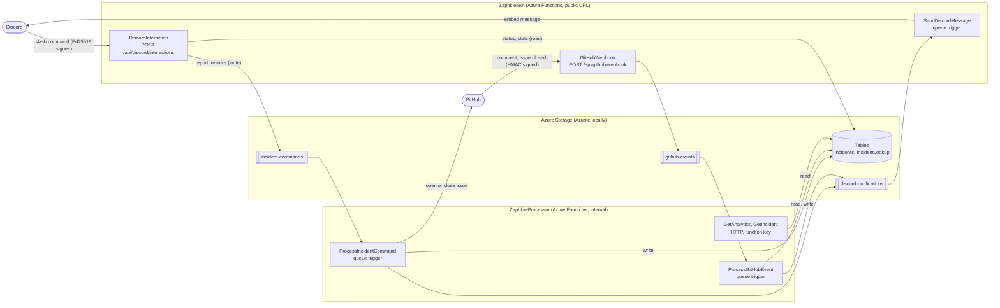
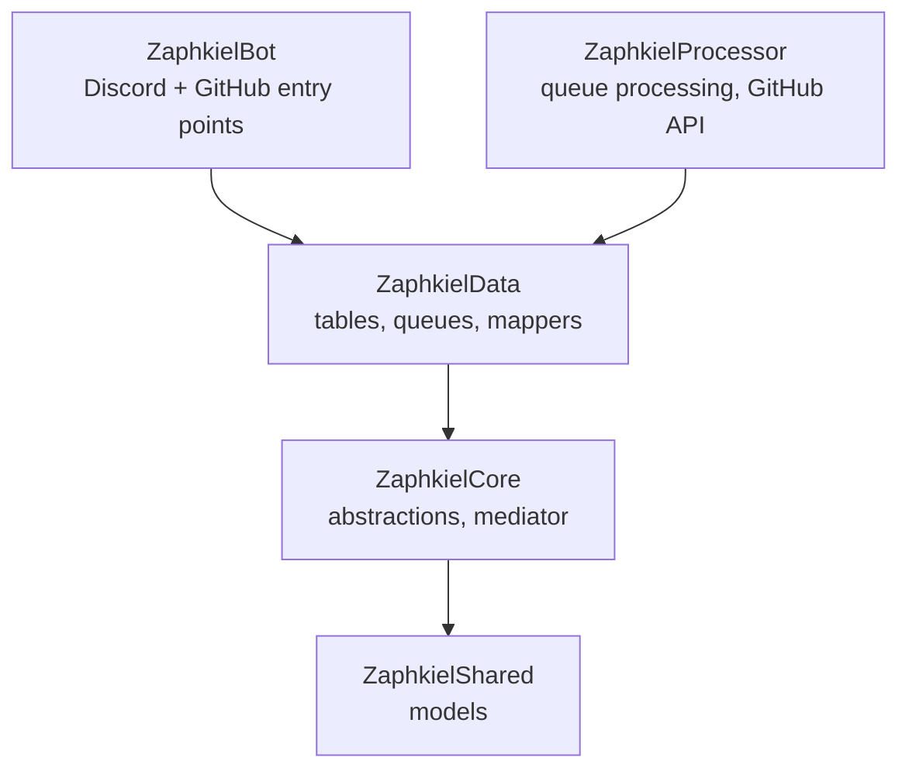

# ZaphkielBot

## Slash commands

| Command                                         | What it does                                                                         |
| ----------------------------------------------- | ------------------------------------------------------------------------------------ |
| `/incident report title severity [description]` | Logs the incident, opens a GitHub issue labelled `incident` and `Severity: <level>`  |
| `/incident resolve id`                          | Marks the incident resolved (stores the time to resolve) and closes the GitHub issue |
| `/incident status id`                           | Shows one incident (private reply)                                                   |
| `/incident stats`                               | Counts per severity and mean time to resolve for the last 30 days (private reply)    |

Severity is `Critical`, `High`, `Medium` or `Low`. Incident ids look like `INC-a1b2c3d4`. The bot answers with embeds,
and posts follow-ups in the channel where the incident was reported:

- the GitHub issue was created
- a developer commented on the issue
- the incident was resolved (in Discord, or by closing the issue on GitHub)

## How it works

Two Azure Functions apps share one Azure Storage account (Azurite when running locally). Nothing calls anything else
directly: every write goes through a storage queue.



## Projects



| Project             | Contents                                                                                                                                                   |
| ------------------- | ---------------------------------------------------------------------------------------------------------------------------------------------------------- |
| `ZaphkielShared`    | Models only: the `Incident` domain model, command and query records, embed and GitHub models, options. No dependencies.                                    |
| `ZaphkielCore`      | Every interface (repositories, queue, GitHub and Discord clients, serializer), the mediator, the queue dispatcher and the shared query handlers.           |
| `ZaphkielData`      | Everything that touches storage: Table Storage repositories (separate read and write), entities, mappers, queue publisher and serializer.                  |
| `ZaphkielBot`       | Azure Functions app. Functions: `DiscordInteraction`, `GitHubWebhook`, `SendDiscordMessage`. The Discord.Net slash command module and the embed mapper.    |
| `ZaphkielProcessor` | Azure Functions app. Functions: `ProcessIncidentCommand`, `ProcessGitHubEvent`, `GetAnalytics`, `GetIncident`. The command handlers and the GitHub client. |

Commands and queries are handled through a small mediator (CQRS): commands go through the queues and change state,
queries only read. All dependencies are interfaces, so every handler and service can be tested with mocks or stubs.

## Data

Azure Table Storage, designed for the queries the bot actually runs:

| Table            | PartitionKey                 | RowKey                                   | Used for                                                                                            |
| ---------------- | ---------------------------- | ---------------------------------------- | --------------------------------------------------------------------------------------------------- |
| `Incidents`      | creation month (`202610`)    | reversed ticks + incident id             | Analytics read one partition per month, newest first, with a RowKey range for the requested period. |
| `IncidentLookup` | `id-<first 2 chars>` or `gh` | incident id, or zero-padded issue number | Finding an incident by id or by GitHub issue number with a point read.                              |

Each incident stores `Severity`, `Status`, `CreatedAt` and `ResolvedAt`, which is what the severity breakdown and MTTR
are computed from.

## Installation

### Prerequisites

- A Discord account and a server where you can add a bot
- A GitHub account and a repository where incident issues will be created
- A way to expose `localhost` over HTTPS, for example [cloudflared](https://developers.cloudflare.com/cloudflare-one/connections/connect-networks/),
  [ngrok](https://ngrok.com/) or VS Code Dev Tunnels
- Optional: the .NET 10 SDK, only if you want to build outside Docker

### 1. Get the code and create your `.env`

```sh
git clone https://github.com/iolite312/ZaphkielBot.git
cd ZaphkielBot
cp .env.example .env
```

You will fill in `.env` over the next steps. The full list of settings is in [Configuration](#configuration).

### 2. Create the Discord bot

1. Open the [Discord Developer Portal](https://discord.com/developers/applications) and create a **New Application**.
2. **General Information**: copy the **Public Key** into `Discord_PublicKey`.
3. **Bot**: click **Reset Token** and copy it into `Discord_BotToken`. No privileged intents are needed.
4. **OAuth2 -> URL Generator**: select the scopes `bot` and `applications.commands`, and the bot permissions
   **View Channel**, **Send Messages** and **Embed Links**. Open the generated URL to add the bot to your server.
5. In Discord, enable **Developer Mode** (User Settings, Advanced). Then right-click your server and choose
   **Copy Server ID** for `Discord_GuildId`, and right-click the channel for incidents and choose **Copy Channel ID**
   for `Discord_IncidentChannelId`. Make sure the bot can see that channel.

### 3. Prepare GitHub

1. Create a **fine-grained personal access token** (Settings, Developer settings, Personal access tokens). Give it access
   to **only the repository** you want the issues in, with the permission **Issues: Read and write**. Put it in
   `GitHub_Token`.
2. Set `GitHub_Owner` to the user or organisation, and `GitHub_Repository` to the repository name.
3. Generate a webhook secret of at least 16 characters and put it in `GitHub_WebhookSecret`:

   ```sh
   openssl rand -hex 32
   ```

### 4. Start the stack

```sh
docker compose up --build
```

This builds both apps and starts Azurite, the bot (<http://localhost:7071>) and the processor (<http://localhost:7072>).
The first build takes a few minutes. The tables and queues are created automatically.

The bot registers the `/incident` command in your server by itself. Look for this line in the log:

```
Registered <n> slash command(s) to guild <your server id>
```

If an app stops right after starting, a setting is missing or malformed. The log names the setting.

### 5. Make the bot reachable

Discord and GitHub need a public HTTPS URL that points at the bot (port 7071). Start a tunnel in a second terminal:

```sh
cloudflared tunnel --url http://localhost:7071
# or
ngrok http 7071
```

Copy the `https://...` address it prints. One tunnel is enough, Discord and GitHub both use it. Free tunnels change
their address every time they start, so repeat steps 6 and 7 when it does.

### 6. Connect Discord

In the Developer Portal, **General Information**, set **Interactions Endpoint URL** to:

```
https://<your-tunnel>/api/discord/interactions
```

Discord checks the URL when you save. It succeeds only if the tunnel reaches the bot and `Discord_PublicKey` is correct.

### 7. Connect GitHub

In your repository, **Settings, Webhooks, Add webhook**:

| Field        | Value                                                                     |
| ------------ | ------------------------------------------------------------------------- |
| Payload URL  | `https://<your-tunnel>/api/github/webhook`                                |
| Content type | `application/json`                                                        |
| Secret       | the value of `GitHub_WebhookSecret`                                       |
| Events       | **select individual events**, then tick **Issues** and **Issue comments** |

After saving, the webhook's **Recent Deliveries** tab should show a green delivery with status 202.

### 8. Try it

1. In the incident channel run `/incident` and fill in the required information.
2. The bot replies with an embed, a GitHub issue appears with the labels `incident` and `Severity: High`, and the bot
   posts the issue link in the channel.
3. Comment on the issue. The comment shows up in the channel.
4. Close the issue, or run `/incident resolve id:<id>`. The bot posts the resolution with the time to resolve.
5. Run `/incident stats` to see the numbers.

## Configuration

Settings are environment variables. A double underscore maps to a configuration section (`Discord_PublicKey` is
`Discord:PublicKey`), which is also how they are entered as Application Settings in Azure.

| Variable                    | Used by   | Required | Description                                                                                                                         |
| --------------------------- | --------- | -------- | ----------------------------------------------------------------------------------------------------------------------------------- |
| `Discord_PublicKey`         | bot       | yes      | 64 hex characters. Verifies that requests really come from Discord.                                                                 |
| `Discord_BotToken`          | bot       | yes      | Registers the slash commands and posts messages.                                                                                    |
| `Discord_IncidentChannelId` | bot       | no       | Restricts the slash commands to this channel. Without it any channel is accepted.                                                   |
| `Discord_GuildId`           | bot       | no       | Registers the commands to this server, which is instant. Without it they are registered globally, which can take a while to appear. |
| `GitHub_WebhookSecret`      | bot       | yes      | At least 16 characters. Verifies that webhooks really come from GitHub.                                                             |
| `GitHub_Token`              | processor | yes      | Fine-grained token with Issues read and write on the repository.                                                                    |
| `GitHub_Owner`              | processor | yes      | Owner of the repository.                                                                                                            |
| `GitHub_Repository`         | processor | yes      | Name of the repository.                                                                                                             |

`AzureWebJobsStorage` is set by `compose.yaml` to point at the Azurite container. When deploying to Azure it must point
at a real storage account.

## Endpoints

| App              | Endpoint                                           | Authentication        | Purpose                                                                |
| ---------------- | -------------------------------------------------- | --------------------- | ---------------------------------------------------------------------- |
| bot (7071)       | `POST /api/discord/interactions`                   | Ed25519 signature     | Slash commands                                                         |
| bot (7071)       | `POST /api/github/webhook`                         | HMAC-SHA256 signature | Issue comments and closed issues                                       |
| processor (7072) | `GET /api/analytics?from=2026-10-01&to=2026-10-31` | function key          | Counts per severity and MTTR (up to 366 days, defaults to the last 30) |
| processor (7072) | `GET /api/incidents/{id}`                          | function key          | One incident                                                           |

`/incident stats` in Discord shows the same numbers as the analytics endpoint without needing a key.
